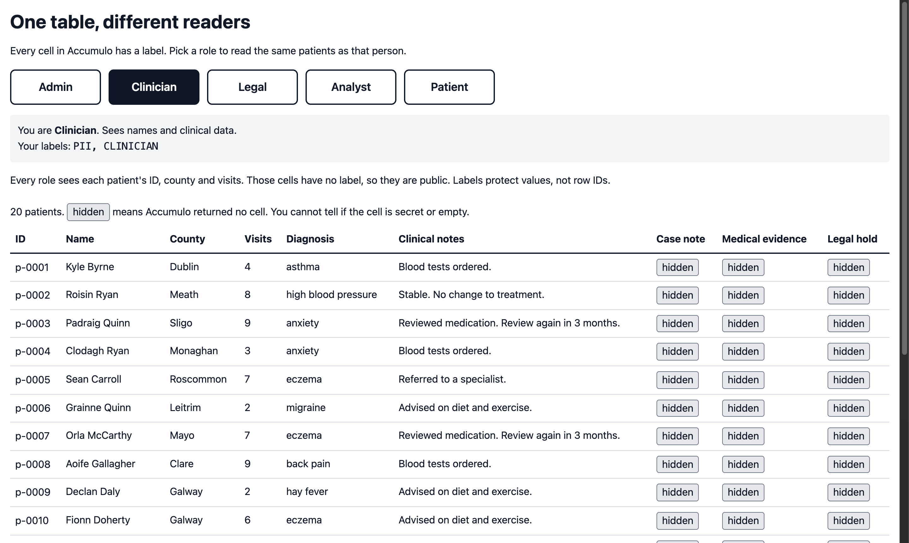
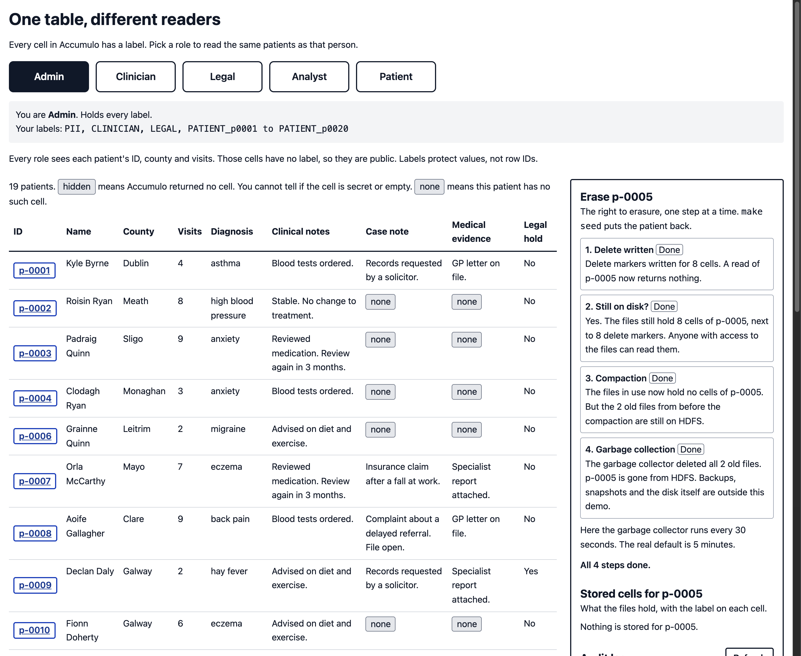
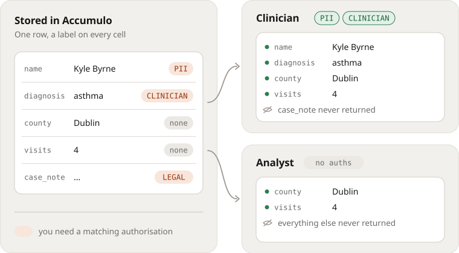

# accumulo-privacy-demo

Apache Accumulo puts a security label on every cell. This demo stores fake
medical and legal records in one table. The same row, read by different
people, returns different cells. A delete then shows how long the data
really stays on disk.



It goes with the blog post
[Privacy at the storage layer: what Accumulo taught me about data lakes](https://blog.benjamin.ie/accumulo-privacy-at-the-storage-layer).

## Run it

You need Docker. On a Mac with Apple Silicon, Docker Desktop works. Run:

```
make up
```

Then open http://localhost:5173.

`make up` builds the images, starts the stack, waits until it is healthy and
writes 20 fake patients. The first build downloads Hadoop and Accumulo, about
800 MB, so it can take several minutes. After that, a restart takes about a
minute.

| Command      | What it does                                             |
|--------------|----------------------------------------------------------|
| `make up`    | Start everything and write the 20 patients               |
| `make seed`  | Write the 20 patients again, which puts back a deleted one |
| `make down`  | Stop everything and keep the data                        |
| `make clean` | Stop everything and delete all data                      |
| `make logs`  | Follow the logs of every service                         |
| `make lint`  | gofmt, go vet, Checkstyle and ESLint                     |
| `make unit`  | Unit tests for the API and the gateway                   |
| `make test`  | Start the stack and run the end-to-end tests             |

Every target runs its tools in Docker. You do not need Java, Maven, Go or
Node installed.

## Try this

1. Click each role. Watch the same 20 patients change.
   - Analyst sees only the county and the visits.
   - Clinician sees names, diagnoses and notes, but no legal cells.
   - Legal sees names and case notes, but no clinical cells and no medical
     evidence.
   - Patient sees their own diagnosis, and no other patient's diagnosis.
2. Click Admin, then a patient id such as `p-0005`. The side panel lists
   every cell that is stored for that patient, with its label.
3. Run the 4 delete steps in the side panel, one at a time.
4. Pick `p-0009` and try to delete it. The API refuses, because that patient
   is on legal hold.
5. Run `make seed` to put the deleted patient back.



## How it works



```
browser
  |
web/        React page, served by nginx on localhost:5173
  |  HTTP, /api is forwarded to the API
api/        Go: roles, legal holds, audit log. localhost:8080
  |  HTTP, internal only
gateway/    Java: all the Accumulo code
  |
accumulo    Accumulo 2.1.6, with HDFS (Hadoop 3.3.6) and ZooKeeper 3.8.8
```

Why a Java gateway? Accumulo's only full client is Java. The old Thrift
proxy is a separate project that few people use. So all the Accumulo code
sits in one small Java service, `gateway/`. The rules of the demo sit in the
Go API: which role gets which labels, who can delete, and the audit log.

### Labels

| Cell                     | Label                     |
|--------------------------|---------------------------|
| `info:name`              | `PII`                     |
| `info:county`            | none, so public           |
| `info:visits`            | none, so public           |
| `clinical:diagnosis`     | `CLINICIAN\|PATIENT_<id>` |
| `clinical:notes`         | `CLINICIAN`               |
| `legal:case_note`        | `LEGAL`                   |
| `legal:medical_evidence` | `LEGAL&CLINICIAN`         |
| `legal:hold`             | `LEGAL`                   |

| Role      | Labels it holds                                       |
|-----------|-------------------------------------------------------|
| Admin     | PII, CLINICIAN, LEGAL, PATIENT_p0001 to PATIENT_p0020 |
| Clinician | PII, CLINICIAN                                        |
| Legal     | PII, LEGAL                                            |
| Analyst   | none                                                  |
| Patient   | PATIENT_<id> only                                     |

The role table is `roleAuths` in `api/roles.go`. Accumulo labels have no
wildcards, so Admin gets one `PATIENT_` label per patient.

Some results follow straight from the labels:

- A patient sees their own diagnosis, but not their own name.
- Every role sees every patient's ID, county and visits. Those cells have no
  label. Labels protect values, not row IDs, so row IDs are opaque, such as
  `p-0001`.
- Only Admin holds both `LEGAL` and `CLINICIAN`, so only Admin sees medical
  evidence.

The gateway connects as one Accumulo user that holds every label. It always
scans with the labels that the API sends, never with its own full set. A
comment in `gateway/src/main/java/gateway/Store.java` states this rule, and a
test checks it.

The table is created with `createtable -evc`. So Accumulo refuses a write
with a label that the writer does not hold, and a typo such as `CLINCIAN`
fails at once.

### The delete flow

1. Delete written. The API writes a delete marker for every cell. A read of
   the patient returns nothing.
2. Still on disk? The gateway reads the table's files directly. They still
   hold every cell of the patient, next to the delete markers.
3. Compaction. Accumulo writes new files without the deleted cells. The
   files in use no longer hold the patient, but the old files are still on
   HDFS.
4. Garbage collection. The gateway remembers which files the compaction
   replaced. It checks HDFS until Accumulo's garbage collector deletes them.

In this demo the garbage collector runs every 30 seconds, so step 4 takes up
to about 30 seconds. The real default is 5 minutes. The setting is
`gc.cycle.delay` in `accumulo/conf/accumulo/accumulo.properties`.

The data can still exist in places that the demo does not show: HDFS trash
(off here), write-ahead logs, HDFS snapshots, the disk itself, and backups.

A legal hold means the record must be kept, so the API refuses to delete
`p-0009` and `p-0011`. The audit log records the refusal.

## What this does not do

- It is not for production. There is no login: the `X-Demo-Role` header sets
  the role, and anyone can send any role. There is no TLS between the
  containers. The passwords are in the repo.
- Every name, condition and note is made up. `gateway/src/main/java/gateway/Seed.java` generates
  them with a fixed random seed.
- The audit log is in memory, so a restart clears it.
- It runs one node of each service. It does not test scale or speed.
- The ports are bound to localhost only. Do not expose them.

## Tests and CI

- `make unit` runs the Go tests in `api/` and the gateway tests in
  `gateway/`. The gateway tests start a MiniAccumuloCluster, run all 4
  delete steps on it, and retry once if a test fails, because the garbage
  collector test depends on timing.
- `make test` starts the stack and runs `api/e2e_test.go` against it. It
  checks every role, the 4-step delete and the legal-hold refusal. Then it
  seeds the data again.
- GitHub Actions runs `make lint`, `make unit` and `make test` on every pull
  request. The end-to-end job takes several minutes, because it builds the
  whole stack.

## Reference

### Services

| Service   | Image                                | Port                    |
|-----------|--------------------------------------|-------------------------|
| zookeeper | `zookeeper:3.8.8-jre-17` (official)  | internal                |
| hdfs      | built from `accumulo/Dockerfile`     | internal                |
| accumulo  | built from `accumulo/Dockerfile`     | internal                |
| gateway   | built from `gateway/Dockerfile`      | internal                |
| api       | built from `api/Dockerfile`          | localhost:8080          |
| web       | built from `web/Dockerfile`          | localhost:5173          |

There is no maintained arm64 image for Accumulo 2.1 or for Hadoop. So
`accumulo/Dockerfile` downloads the Apache release files and checks their
SHA-512 sums. One image runs both HDFS and Accumulo, with a different start
script each.

On first start, `accumulo/init.sh` creates the `patients` table and the
`gateway` user. The health check passes only when the table can serve a
scan. `make down` stops Accumulo cleanly, so the next start has no
write-ahead log to replay.

If your data is older than the `-evc` change, run `make clean` one time.

### API

| Endpoint                     | Who        | What it does                                  |
|------------------------------|------------|-----------------------------------------------|
| `GET /api/me`                | every role | The role and its labels                       |
| `GET /api/patients`          | every role | Every patient, visible cells only             |
| `GET /api/patients/{id}`     | every role | One patient, visible cells only               |
| `DELETE /api/patients/{id}`  | Admin      | Writes delete markers for the row             |
| `GET /api/patients/{id}/raw` | Admin      | What the files still hold                     |
| `POST /api/compact`          | Admin      | Runs a full compaction                        |
| `GET /api/old-files`         | Admin      | The files the compaction replaced, if on HDFS |
| `GET /api/audit`             | Admin      | The last 100 reads and deletes                |

Send the role in `X-Demo-Role`. The Patient role also needs
`X-Demo-Patient`, for example `p-0001`:

```
curl -H "X-Demo-Role: Analyst" http://localhost:8080/api/patients/p-0001
curl -H "X-Demo-Role: Patient" -H "X-Demo-Patient: p-0001" http://localhost:8080/api/patients
```

### Gateway

Internal only. The API is its only caller.

| Endpoint                      | What it does                                         |
|-------------------------------|------------------------------------------------------|
| `POST /write`                 | Writes one cell with a label                         |
| `GET /scan?row=...&auths=A,B` | Returns the cells that those labels can see          |
| `POST /delete`                | Writes a delete marker for every cell in a row       |
| `POST /compact`               | Runs a full compaction and waits for it              |
| `GET /old-files`              | Checks HDFS for the files the last compaction replaced |
| `GET /raw?row=...`            | Reads the row from the table files, with no filters  |

### Working on the web page

With the stack running, start Vite with live reload:

```
cd web
npm ci
npm run dev
```

`npm run dev` forwards `/api` to http://localhost:8080.

## Licence

MIT. See [LICENSE](LICENSE).
